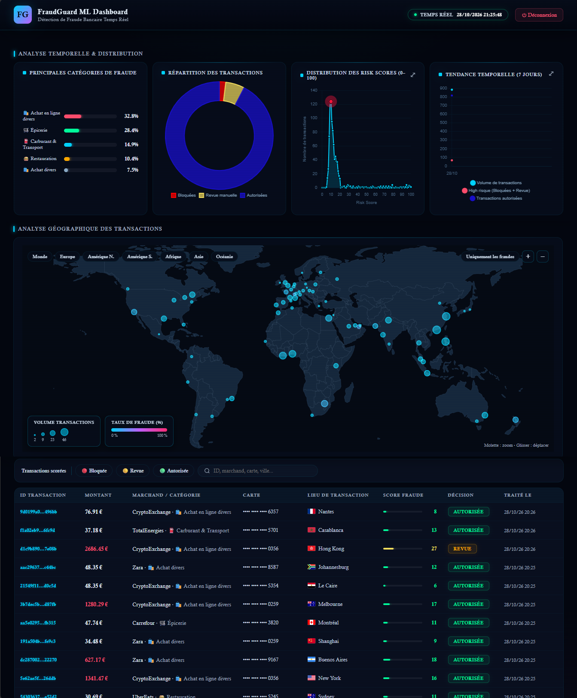
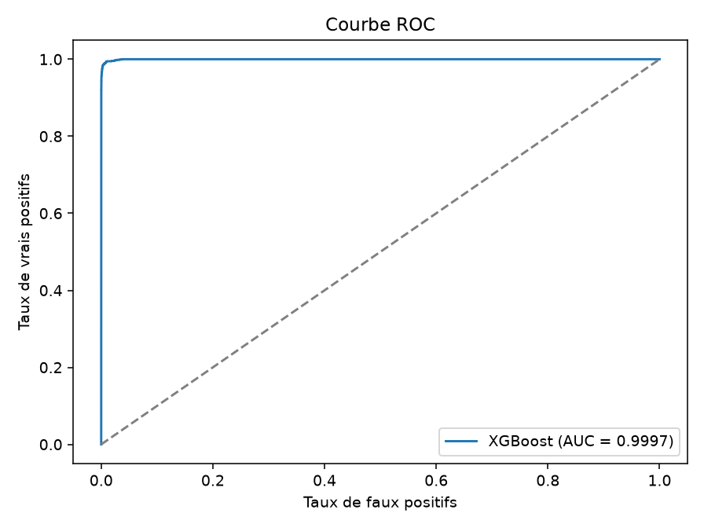
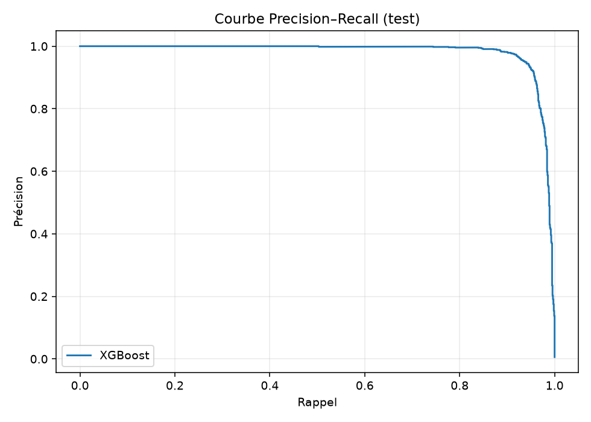
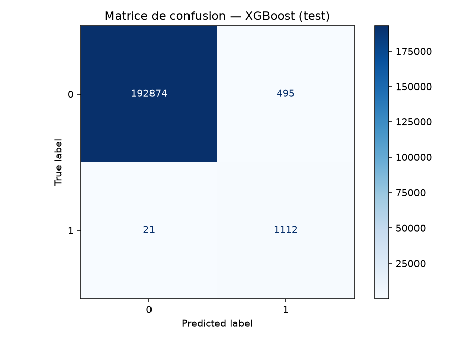
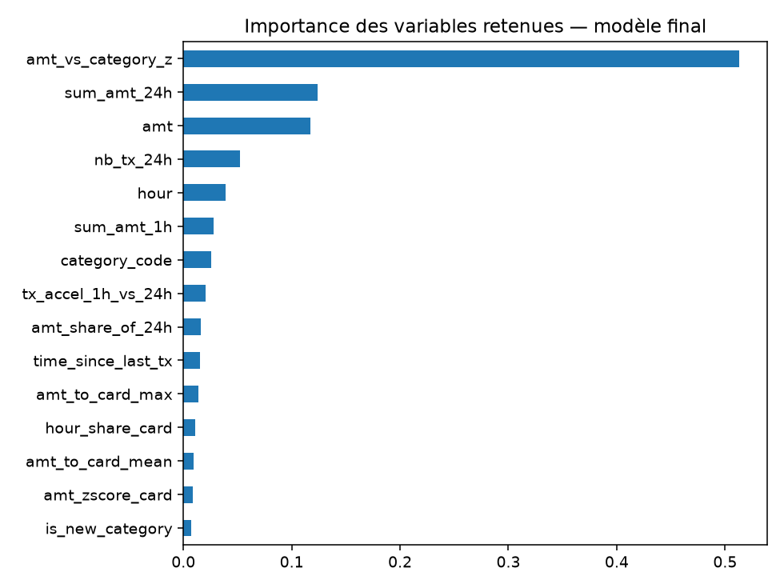

# 🛡️ FraudGuard ML — Détection de fraude bancaire en temps réel

> Plateforme de bout en bout : modèle XGBoost calibré, API de scoring FastAPI, décision en 3 bandes (Autorisée / Revue / Bloquée) et dashboard analytique avec explications pour les analystes fraude.



---

## ✨ Points clés

- **Pipeline complet** : entraînement → artefact versionné → API de scoring → dashboard temps réel
- **Validation chronologique** : train 70 % / calibration 7,5 % / seuils 7,5 % / test 15 %, sans aucun mélange temporel
- **Calibration de Platt sur la marge** XGBoost : de vraies probabilités, utilisables pour fixer des seuils métier
- **Seuils pilotés par le coût métier** (coût d'un faux négatif dépendant du montant) puis traduits en 3 bandes de décision
- **Features causales à l'inférence** : l'historique d'une carte ne contient que des transactions strictement antérieures
- **Explicabilité** : analyse en langage naturel (signaux d'alerte / signaux rassurants) et métriques comportementales par transaction
- **Rapports d'entraînement automatiques** : qualité des features (PSI, AUC univariée), stabilité par période, fraudes manquées

---

## 📊 Résultats

Entraînement et évaluation sur le dataset public **Credit Card Transactions Fraud Detection** (Kaggle, `fraudTrain`, 1 296 675 transactions, 0,58 % de fraudes).
Évaluation sur le **test chronologique final : 194 502 transactions, 1 133 fraudes** (jamais utilisé pour la calibration ni le choix des seuils).

| Métrique | Valeur |
|---|---|
| PR-AUC | **0,981** |
| ROC-AUC | **0,9997** |
| Rappel (seuil de coût 0,02) | **98,2 %** |
| Précision (seuil de coût 0,02) | 69,2 % |
| F1-score | 0,812 |
| Montant frauduleux détecté | 601 623 $ |

### Décision en 3 bandes (test)

| Bande | Part des transactions | Fraudes | Rôle |
|---|---|---|---|
| ✅ Autorisée (score < 20) | 98,94 % | 14 | Passage automatique |
| 🟡 Revue manuelle (20–80) | 0,48 % (≈ 4,75 / 1000 tx) | 49 | Analyste |
| 🔴 Bloquée (score ≥ 80) | 0,58 % | 1 070 | Blocage automatique |

- **98,76 %** des fraudes sont interceptées (Bloquée + Revue)
- **94,4 %** des fraudes sont bloquées automatiquement, avec une précision de blocage de **94,4 %**
- Charge de revue : **0,48 %** du flux, très en dessous du plafond fixé à 5 %

### Stabilité dans le temps (4 tranches chronologiques du test)

| Période | Transactions | Fraudes | PR-AUC | Rappel (Bloquée + Revue) | Précision blocage |
|---|---|---|---|---|---|
| 1 | 48 626 | 209 | 0,969 | 98,6 % | 93,7 % |
| 2 | 48 626 | 351 | 0,995 | 100 % | 95,0 % |
| 3 | 48 625 | 261 | 0,982 | 98,9 % | 92,5 % |
| 4 | 48 625 | 312 | 0,972 | 97,4 % | 95,7 % |

### Courbes d'évaluation

| ROC | Precision–Recall |
|---|---|
|  |  |

| Matrice de confusion | Importance des variables |
|---|---|
|  |  |

---

## 🧠 Approche ML

### Features (15 retenues sur 19 candidates)

| Famille | Variables |
|---|---|
| Montant | `amt`, `amt_vs_category_z`, `amt_zscore_card`, `amt_to_card_mean`, `amt_to_card_max` |
| Vélocité | `nb_tx_24h`, `sum_amt_24h`, `sum_amt_1h`, `tx_accel_1h_vs_24h`, `amt_share_of_24h`, `time_since_last_tx` |
| Comportement | `is_new_category`, `category_code`, `hour`, `hour_share_card` |

**Sélection en deux étapes** : un modèle « éclaireur » classe les features par gain cumulé (seuil 95 %), puis les features de comportement personnel de la carte sont forcées dans le modèle final.
**Garde-fous** : les features à fuite potentielle (`merchant_freq`, `category_share_card`) et celles dont la valeur serait peu fiable à l'inférence (vitesse, distance au marchand précédent) sont écartées volontairement.

### Modélisation

- **XGBoost** (400 arbres, profondeur 6) avec `scale_pos_weight` atténué (`(n_neg/n_pos)^0,5`) pour le déséquilibre de classes
- **Calibration de Platt sur la marge brute** plutôt que sur `predict_proba` : évite l'écrasement des probabilités au plancher et conserve la résolution sur le bas de l'échelle
- **Score de risque 0–100 en échelle logarithmique** pour distinguer finement les très faibles probabilités
- **Isolation Forest** entraîné et évalué comme signal non supervisé (ROC-AUC 0,967)

### Seuils pilotés par le métier

| Seuil | Règle |
|---|---|
| Seuil de décision | Meilleur F1 parmi les seuils dont le coût estimé est à moins de 5 % du minimum (FN : 200 $ + 0,5 × montant, borné à [50, 2000] ; FP : 10 $) |
| `t_low` (Autorisée → Revue) | Quantile 99,5 % des probabilités des transactions légitimes (validation) |
| `t_high` (Revue → Bloquée) | Plus petit seuil garantissant une précision ≥ 95 % (validation) |
| Plafond de revue | 5 % maximum du flux |

---

## ⚙️ API de scoring

- **FastAPI** + **SQLite** : chaque transaction est scorée, journalisée et ajoutée à la mémoire de la carte
- **Features causales** : fenêtres glissantes 1 h / 6 h / 24 h / 7 j calculées sur l'historique strictement antérieur à la transaction
- **Parité entraînement / inférence** : unités de temps, écart-type (ddof = 1) et statistiques par catégorie appris à l'entraînement et rechargés depuis l'artefact
- **Artefact vérifié** au chargement (clés, cohérence `p_floor < t_low < t_high`)
- **Mémoire initiale** : rejeu d'un historique de transactions avant le flux en direct (`historique.py`)

## 🖥️ Dashboard

- **Vue temps réel** des transactions scorées, avec recherche par ID, marchand, carte ou ville
- **Analyse temporelle** : répartition des décisions, distribution des risk scores, tendance sur 7 jours
- **Analyse géographique** : carte mondiale avec volume et taux de fraude par ville, filtres par continent
- **Fiche transaction** : score, décision, analyse IA, métriques comportementales (z-score, vélocité, affinité marchand, intervalle inter-transactions)
- **Historique par carte**, export JSON, authentification (mots de passe hachés PBKDF2-SHA256, 200 000 itérations)

---

## 🏗️ Architecture

```
 Dataset Kaggle ──► train.py ──► models/fraud_xgb_model.joblib + reports/
                                         │
 Ingestion.py ──► API_Score.py (FastAPI :8001) ──► SQLite (fraud.db)
 (flux simulé)    features causales + scoring               │
                  décision 3 bandes                         ▼
                                              dashboard.py (FastAPI :8002)
```

**Stack** : Python · XGBoost · scikit-learn · pandas · FastAPI · SQLite · Uvicorn · HTML/CSS/JS

---

## 🔁 Flux de démonstration

Pour alimenter le dashboard, un **simulateur d'ingestion** (`Ingestion.py`) génère un flux de transactions en continu : clients avec domicile fixe, lieux de transaction mondiaux (80 villes), comportements normaux et scénarios frauduleux (montants anormaux, rafales de transactions, voyages lointains). Il permet de voir le système réagir en direct, sans aucune donnée bancaire réelle.

---

## 🚀 Installation

```bash
git clone https://github.com/<ton-user>/<ton-repo>.git
cd <ton-repo>

python -m venv .venv
source .venv/bin/activate        # Windows : .venv\Scripts\activate
pip install -r requirements.txt
```

1. **Données** : télécharger le dataset Kaggle et placer le fichier préparé dans `data/` (voir `data/README.md`)
2. **Entraînement** : `python Train_ML.py --data data/fraudTrain_clean.csv` (génère `models/` et `reports/`)
3. **API de scoring** : `python API_Score.py` (port 8001)
4. **Historique** : `python historique.py`
5. **Flux en direct** : `python Ingestion.py`
6. **Dashboard** : `python dashboard.py` (port 8002)

Les paramètres se règlent par variables d'environnement (voir `.env.example`).

---

## 📁 Structure du projet

```
├── Train_ML.py        # Entraînement, calibration, seuils, rapports
├── calibration.py     # Calibrateur de Platt sur la marge XGBoost
├── API_Score.py       # API de scoring (FastAPI)
├── Ingestion.py       # Simulateur de flux de transactions
├── historique.py      # Rejeu de l'historique avant le flux
├── world_cities.py    # Villes partagées (ingestion, historique, dashboard)
├── dashboard.py       # Dashboard web
├── models/            # Artefact du modèle
├── reports/           # Métriques, graphiques, rapports qualité
└── docs/screenshots/
```

---

## 🗺️ Roadmap

- [ ] Réintégrer la vitesse et la distance au marchand précédent (voyage impossible) une fois la parité entraînement / inférence validée
- [ ] Explicabilité SHAP par transaction
- [ ] Benchmark sur un second dataset public
- [ ] Baselines de comparaison (régression logistique, règles métier)
- [ ] Monitoring de dérive (PSI) et ré-entraînement automatique

---

## 👤 Auteur

**[Ton nom]** — [LinkedIn](https://linkedin.com/in/...) · [Email](mailto:...)
